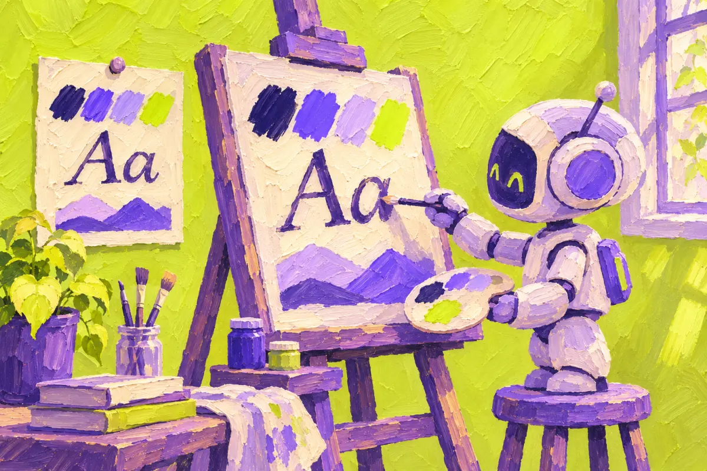
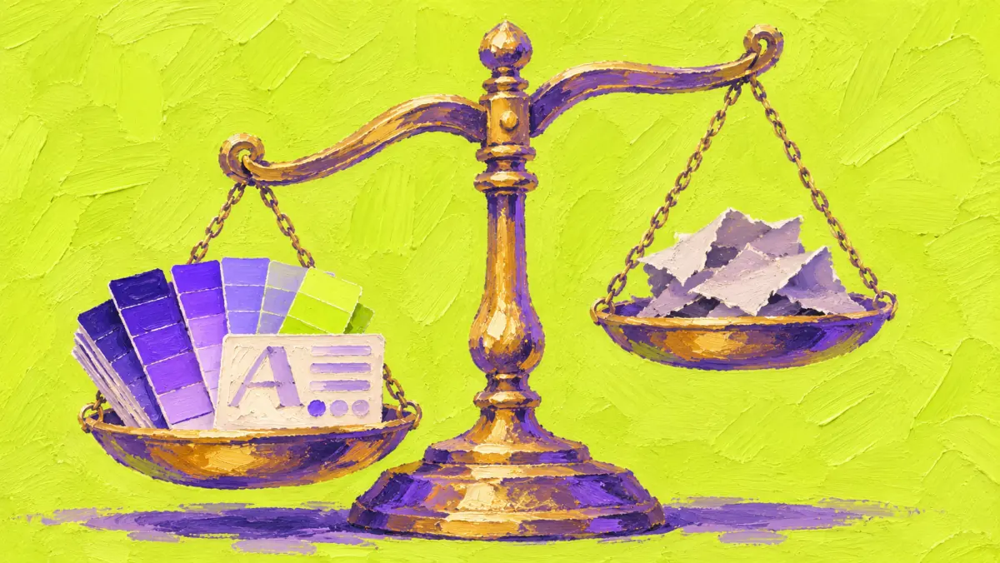

<p align="center">
  
</p>

<p align="center">
  <a href="https://www.npmjs.com/package/designlang"></a>
  <a href="https://github.com/Manavarya09/design-extract/blob/main/LICENSE"></a>
  <a href="https://nodejs.org"></a>
  <a href="https://designlang.app/"></a>

</p>

<p align="center">
  <a href="https://trendshift.io/repositories/26231?utm_source=trendshift-badge&amp;utm_medium=badge&amp;utm_campaign=badge-trendshift-26231" target="_blank" rel="noopener noreferrer"></a>
  <a href="https://trendshift.io/repositories/26231?utm_source=trendshift-badge&amp;utm_medium=badge&amp;utm_campaign=badge-trendshift-26231" target="_blank" rel="noopener noreferrer"></a>
</p>

<p align="center">
  Built by <a href="https://www.manavaryasingh.com">Manav Arya Singh</a> (<a href="https://github.com/Manavarya09">@Manavarya09</a>)
</p>

<p align="center">
  
</p>


## Sponsors

<p align="center">
  <a href="https://www.atlascloud.ai/?utm_source=github&utm_medium=referral&utm_campaign=design-extract">
    
  </a>
  &nbsp;&nbsp;&nbsp;&nbsp;
  <a href="https://bloome.im/agent/join/XP8NQwFj?ref=9ZZRRy82">
    
  </a>
</p>

<p align="center">
  <strong><a href="https://www.atlascloud.ai/?utm_source=github&utm_medium=referral&utm_campaign=design-extract">Atlas Cloud</a></strong> — powers OpenAI-compatible <code>--smart</code> classification. For AI coding workflows, try the <a href="https://www.atlascloud.ai/console/coding-plan?utm_source=github&utm_medium=referral&utm_campaign=design-extract">Atlas Cloud coding plan</a>.
  <br>
  <strong><a href="https://bloome.im/agent/join/XP8NQwFj?ref=9ZZRRy82">Bloome</a></strong> — deploys your AI clone to handle every audience conversation, running in the cloud, 24/7.
  <br>
  Try designlang on <a href="https://bloome.im/agent/join/XP8NQwFj?ref=9ZZRRy82">Bloome</a>.
</p>

---

**designlang** points a headless browser at any URL and reads the design system off the live DOM. One command emits 17+ files — DTCG tokens, Tailwind config, shadcn theme, Figma variables, motion tokens, typed component anatomy, brand voice, page-intent labels, and a paste-ready prompt pack for v0 / Lovable / Cursor / Claude Artifacts.

It also goes where extractors don't: **layout patterns**, **responsive behavior across 4 breakpoints**, **hover / focus / active states**, **WCAG contrast scoring**, **multi-page consistency**, **drift checks against a live source-of-truth**, **visual-diffs**, and a **shareable graded report card**.

## Quick start

<p align="center">
  
</p>

```bash
npx designlang https://stripe.com                      # extract everything: tokens, Tailwind, shadcn, Figma, DESIGN.md
npx designlang slop https://yoursite.com               # how generic does it look? a score out of 100, with every tell
npx designlang verify-ui localhost:3000 --brand DESIGN.md  # check your UI against your brand at 390, 768 and 1280px
npx designlang mcp                                     # give Claude Code, Cursor and Windsurf your design system
npx designlang dna stripe.com                          # place it in the measured design space: neighbours + percentiles
npx designlang site stripe.com                         # whole-site: one canonical system + consistency grade
npx designlang fidelity stripe.com --clone localhost:3000  # score a clone against the original (visual + motion)
npx designlang studio                                  # live token editor: edit, preview, export, share
npx designlang brand stripe.com                        # full brand-guidelines book (13 chapters)
npx designlang pair stripe.com linear.app              # fuse two designs (visuals from A, voice from B)
npx designlang theme-swap stripe.com --primary "#ff4800"  # recolour around your brand
npx designlang pack stripe.com                         # one polished design-system directory
npx designlang remix stripe.com --as cyberpunk         # restyle in another vocabulary (--all for all six)
npx designlang grade https://stripe.com --badge        # report card + SVG badge
npx designlang battle stripe.com vercel.com            # head-to-head graded fight
npx designlang clone https://stripe.com                # working Next.js starter
npx designlang --full https://stripe.com               # screenshots + responsive + interactions
```

Needs Node.js 20 or later. No account, no API key.

Drop a live design-score badge in any README:

```markdown

```

## Is it generic? (`slop`) and is it on brand? (`verify-ui`)

`designlang slop <url>` opens the page in a real browser and scores how generic it looks, from 0 (distinct) to 100 (generic), listing each known AI-design tell it found with what was measured and where. Add `--brand DESIGN.md` to also score how close the page is to your brand. Try it in the browser at [designlang.app/slop](https://designlang.app/slop).

`designlang verify-ui <url> --brand <DESIGN.md or tokens>` checks a screen, `localhost` included, at phone, tablet and desktop widths and in dark mode. It returns pass or fail, an on-brand score, and every drift with the expected and actual value. It exits 1 on drift, so it can gate CI. Your AI editor can run the same check itself through the MCP tool `verify_ui`.

## Watch it read — live Extraction Theatre (`v13`)

<p align="center">
  
</p>

Don't take the output on faith — **watch it happen.** On
[designlang.app/watch](https://designlang.app/watch) you paste a URL and a real
headless Chromium opens the page and reads its entire design system in real
time: a split stage with the live browser on the left and the design system —
palette, type, spacing, motion — assembling itself on the right as each token
lifts off the page.

It's driven by the *actual* extraction (the browser's CDP screencast streamed
frame-by-frame alongside the real token events), recorded so a shared link
replays the exact run. No install, no account. Every gallery card can be watched
the same way, and the [gallery](https://designlang.app/gallery) now spans **37
real-graded design systems**.

## Whole-site design system (`site`)

Most extractors read a single URL. `designlang site` crawls a site's canonical
pages (home, pricing, docs, blog, about, product…) and synthesizes **one**
de-duplicated system. Every token is elected by *coverage* — the share of pages
that use it — so what's genuinely site-wide is separated from one-off,
page-local choices. Near-identical colours are merged in OKLab. It's fully
deterministic and free; no API key.

```bash
npx designlang site stripe.com --max-pages 8
```

You get, alongside the standard pack emitted from the **canonical** system:

| File | What it is |
|---|---|
| `*-site-system.json` | canonical unified tokens + coverage + drift |
| `*-site-coverage.md` | every token tagged 🟢 site-wide / 🟡 section / 🔴 page-local, with the pages using it |
| `*-site-consistency.md` | a 0–100 consistency grade, per-category breakdown, and the off-system outliers to consolidate |

## Measured clone fidelity (`fidelity` + `gallery`)

<p align="center">
  
</p>

Cloning tools all *claim* "pixel-perfect" — none of them **measure** it. `designlang
fidelity` does. Point it at the original and your clone (often a local dev
server) and it returns one honest number, both halves of the clone:

- **Visual** — full-page screenshots of each, pixel-diffed.
- **Motion** — `extractMotion()` on both, compared across feel, durations,
  easings, springs, keyframe kinds, scroll-linked motion, and choreography/
  stagger. (Most clones reproduce static pixels and drop the motion entirely;
  this is where they lose.)

The two blend into a 0–100 score + letter grade, and — the part competitors
don't ship — a **ranked correction plan**: the exact next edits that will raise
the score, hardest-hitting first. Measure → fix → re-run until it converges.

```bash
npx designlang fidelity https://stripe.com --clone http://localhost:3000
npx designlang fidelity https://stripe.com --clone http://localhost:3000 --min 90   # CI gate
```

Generating the clone with `designlang clone`? Add `--fidelity` and it grades the
clone's token basis against the live site the moment it's built — writing
`FIDELITY.md` + a correction plan straight into the project, no separate step:

```bash
npx designlang clone https://stripe.com --fidelity
```

You get `fidelity.md` (score + motion table + correction plan), `fidelity.json`,
a shareable `fidelity-card.svg` (`88% · B · stripe.com`), and a `fidelity-diff.png`
loss heatmap.

Then publish them. `designlang gallery` scans your reports and builds a
deployable static site — an index of score cards plus a permalink page per clone
(each with an OG card, so a shared link unfurls the number).

```bash
npx designlang gallery --title "Our clones" --base-url https://clones.example.com
```

## A measured design space (`dna`)

Every extractor on the market answers *what* a design uses. None of them answers
**where it sits**. `designlang grade` returns a letter — but a letter with no
reference frame is a thermometer with no scale on it.

`designlang dna` reduces a design to **30 deterministic features** across five
axes — colour, type, space, shape, motion — and ranks it against a corpus of
real design systems:

```bash
npx designlang dna raycast.com
```

```
  Design DNA · https://raycast.com
  30 features, 100% measurable

  vs 8 systems (default)

  color    65th percentile
  type     56th percentile
  space    42th percentile
  shape    79th percentile
  motion   67th percentile

  Nearest
  0.14  https://railway.app
  0.15  https://linear.app
  0.19  https://notion.so
```

Distance is the mean absolute difference across the features both designs have,
so `0.14` reads as "the average feature is 14% of its range apart" — a number you
can reason about, unlike a Euclidean distance in 30 dimensions.

The report goes past similarity to **what makes a design look the way it does**:
the features furthest from the middle of the corpus, in plain language
(*"corner radius — 100th percentile, far above the corpus"*).

Bring your own reference frame — your products, your competitors, a target look:

```bash
npx designlang dna-corpus acme.com acme.com/pricing competitor.com
npx designlang dna acme.com/new-page --corpus ./corpus.json
```

Three things it refuses to do, because a design score that overclaims is worse
than no score at all:

- **A missing measurement stays missing.** Features the page never exposed are
  `null`, never a substituted midpoint, and distance skips them instead of
  comparing against an invented value.
- **Every number carries its evidence.** Distances report how many features
  backed them, percentiles name the corpus and its size, and the report warns
  when coverage was partial.
- **The space is versioned.** Feature order and normalization are frozen per
  vector version, and a corpus built by different rules is rejected rather than
  silently compared against.

## Install

```bash
npm i -g designlang                         # global
designlang install-browser                  # one-time: the Chromium designlang drives
npx skills add Manavarya09/design-extract   # as an agent skill (40+ agents)
```

`npm install` no longer downloads a browser, so it works in CI, Docker and
behind proxies. `install-browser` fetches the Chromium matching the bundled
Playwright (add `--with-deps` on bare Linux). Without it, designlang falls back
to an installed Google Chrome.

## Use in Claude Code (plugin)

<p align="center">
  
</p>

designlang ships as a **Claude Code plugin** — eleven slash commands that wrap
the CLI. Install it from inside Claude Code:

```text
/plugin marketplace add Manavarya09/design-extract
/plugin install designlang@designlang
```

The first command registers this repo as a plugin marketplace; the second
installs the `designlang` plugin from it. Restart Claude Code if prompted, then
the commands are available:

| Command | What it does |
|---|---|
| `/extract <url>` | full design language → DTCG, Tailwind, Figma, motion, voice |
| `/site <url>` | crawl a whole site → one canonical design system + consistency grade |
| `/grade <url>` | shareable HTML report card + SVG badge |
| `/battle <a> <b>` | head-to-head graded comparison |
| `/remix <url> --as <vocab>` | restyle in 6 vocabularies (brutalist, swiss, art-deco, cyberpunk, soft-ui, editorial) |
| `/pack <url>` | one downloadable design-system bundle |
| `/theme-swap <url>` | OKLCH-correct recolour around a new brand primary |
| `/brand <url>` | full editorial brand-guidelines book (13 chapters) |
| `/pair <a> <b>` | fuse two designs across configurable axes |
| `/studio` | live token editor — preview, dark mode, export, share |
| `/verify <url>` | rebuild from tokens, pixel-diff vs live, fidelity score |
| `/fidelity <url> --clone <url>` | score a clone vs the original (visual + motion) + correction plan |
| `/gallery [dir]` | build a static shareable gallery of measured clones |
| `/dna <url>` | place a design in the measured design space — nearest systems, per-axis percentiles, outliers |

> Prefer raw MCP tools? The CLI ships an MCP server that extracts live URLs:
>
> ```bash
> claude mcp add designlang -- npx -y designlang mcp
> ```
>
> `extract_design(url)` returns a job id; poll `get_job_status`, then pass the
> id to `get_tokens`, `get_colors`, `get_typography`, `get_components`,
> `get_findings`, `compute_drift` (against a baseline job) or `export`
> (dtcg, tailwind, shadcn, figma, css, design-md). Add `--output-dir <dir>` to
> also serve an extraction already on disk as resources.

## Atlas Cloud for `--smart`

`designlang --smart` can now use Atlas Cloud through its OpenAI-compatible chat API, so low-confidence classifiers can stay zero-dependency while routing to Atlas-hosted models.

```bash
export ATLASCLOUD_API_KEY="<atlascloud-api-key>"
export ATLASCLOUD_MODEL="deepseek-ai/deepseek-v4-pro"

npx designlang https://stripe.com --smart
```

- Atlas Cloud envs: `ATLASCLOUD_API_KEY`, `ATLASCLOUD_MODEL`, optional `ATLASCLOUD_API_BASE`
- Alias envs also work: `ATLAS_CLOUD_API_KEY`, `ATLAS_CLOUD_MODEL`, `ATLAS_CLOUD_API_BASE`
- Existing `OPENAI_API_KEY` and `ANTHROPIC_API_KEY` flows keep working unchanged

## What you get

<p align="center">
  
</p>

Each run writes 17+ files to `./design-extract-output/`. The headline outputs:

| File | What it is |
|---|---|
| `*-design-language.md` | 19-section markdown — feed any LLM to recreate the design |
| `*-design-tokens.json` | W3C DTCG tokens (primitive + semantic + composite layers) |
| `*-tailwind.config.js` | Drop-in Tailwind theme |
| `*-shadcn-theme.css` | shadcn/ui `globals.css` variables |
| `*-figma-variables.json` | Figma Variables import (light + dark) |
| `*-variables.css` | CSS custom properties |
| `*-anatomy.tsx` | Typed React stubs for every detected component + variants |
| `*-motion-tokens.json` | Durations, easings, springs, scroll-linked flag; with `--motion-runtime` also choreography (stagger) + scroll recipes + observed durations |
| `*-voice.json` | Brand voice — tone, pronoun posture, CTA verbs |
| `*-prompts/` | Paste-ready prompts for v0, Lovable, Cursor, Claude Artifacts |
| `*-mcp.json` | Disk-backed MCP server payload |
| `*-grade.html` | **v12.1** Shareable Design Report Card (letter grade + evidence) |
| `*-grade.svg` | **v12.2** Shields.io-style design-score badge (drop into any README) |
| `*-battle.html` | **v12.2** Head-to-head graded battle card from `designlang battle` |
| `*-remix.<vocab>.html` | **v12.3** Site restyled in another vocabulary — brutalist / swiss / art-deco / cyberpunk / soft-ui / editorial |

Multi-platform (`--platforms web,ios,android,flutter,wordpress,all`) adds `ios/`, `android/`, `flutter/`, and a WordPress block theme. `--emit-agent-rules` adds Cursor / Claude Code / generic agent rule files.

## Why designlang vs anything else

<p align="center">
  
</p>

Other tools give you the paint. designlang reads the architecture:

- **Layout system** — grids, flex containers, container widths, gaps — not just tokens.
- **Responsive** — crawls 4 breakpoints and reports what changes (`--responsive`).
- **Interaction states** — programmatically hovers and focuses, captures the deltas (`--interactions`, `--deep-interact`).
- **Motion language** — durations, easing families, spring detection, scroll-linked flag, `feel` fingerprint (springy / smooth / mechanical / mixed).
- **Runtime motion (`--motion-runtime`)** — drives the page (load / scroll / hover / focus) and reads `document.getAnimations()` to capture what *actually* animates: real durations, **choreography/stagger** sequences, and **scroll recipes** (parallax / reveal / pin). Folded into `*-motion-tokens.json` and previewable live in the studio's Motion tab.
- **Component anatomy** — slot trees with variant × size × state matrices, emitted as typed `.tsx`.
- **Brand voice** — tone, pronoun posture, heading style, CTA verb inventory.
- **Page intent + section roles** — `landing` / `pricing` / `docs` etc., with semantic regions (`hero`, `feature-grid`, `pricing-table`, `cta`…).
- **Multi-page consistency** — auto-discovers canonical pages, reconciles shared vs per-route tokens.
- **WCAG** — every fg/bg pair scored, with a remediation palette suggesting nearest passing colors.
- **Drift + lint + visual-diff** — `designlang drift`, `lint`, `visual-diff` all CI-ready, exit non-zero on failure.
- **Live-site sync** — treat the deployed site as source of truth (`designlang sync`).
- **MCP server** — `designlang mcp` exposes tokens, regions, components, and contrast pairs to any MCP-aware agent.

```bash
designlang grade https://stripe.com         # ← v12.1: shareable report card
designlang clone https://stripe.com         # → working Next.js app
designlang apply https://stripe.com -d ./app   # auto-detect framework, write tokens
designlang brands stripe.com vercel.com linear.app   # N-brand matrix
designlang drift https://yourapp.com --tokens ./src/tokens.json
designlang lint ./src/tokens/design-tokens.json     # CI-ready linter
designlang visual-diff https://staging.app https://app   # single-file HTML diff
designlang mcp                              # stdio MCP server for Cursor / Claude Code
designlang doctor                           # sanity-check the local install
```

## All features

| Feature | Flag / Command | Description |
|---------|---------------|-------------|
| Base extraction | `designlang <url>` | Colors, typography, spacing, shadows, radii, CSS vars, breakpoints, animations, components |
| Layout system | automatic | Grid patterns, flex usage, container widths, gap values |
| Accessibility | automatic | WCAG 2.1 contrast ratios for all fg/bg pairs |
| Design scoring | automatic | 7-category quality rating (A-F) with actionable issues |
| Gradients | automatic | Gradient type, direction, stops, classification |
| Z-index map | automatic | Layer hierarchy, z-index wars detection |
| SVG icons | automatic | Deduplicated icons, size/style classification, color palette |
| Font files | automatic | Source detection (Google/self-hosted/CDN/system), @font-face CSS |
| Image styles | automatic | Aspect ratios, shapes, filters, pattern classification |
| Dark mode | `--dark` | Extracts dark color scheme + light/dark diff |
| Auth pages | `--cookie`, `--cookie-file`, `--header` | Extract from authenticated/protected pages; cookie files in JSON / Playwright storageState / Netscape formats |
| Self-signed / dev TLS | `--insecure` | Ignore HTTPS/SSL certificate errors |
| User-Agent override | `--user-agent <ua>` | Set a custom User-Agent string |
| Chrome extension | `chrome-extension/` | One-click handoff from any tab, MV3, `activeTab` only |
| Multi-page | `--depth <n>` | Crawl N internal pages; emits shared-vs-per-route token reconciliation (`*-tokens-shared.json`, `*-tokens-routes/<slug>.json`, `*-routes-report.md`) |
| Screenshots | `--screenshots` | Capture buttons, cards, inputs, nav, hero, full page |
| Responsive | `--responsive` | Crawl at 4 viewports, map breakpoint changes |
| Interactions | `--interactions` | Capture hover/focus/active state transitions |
| Auto-interact | `--deep-interact` | Scroll, open menus/modals/accordions, hover CTAs before extraction |
| Runtime motion | `--motion-runtime` | Capture real motion via `document.getAnimations()` — durations, stagger/choreography, scroll recipes |
| Everything | `--full` | Enable screenshots + responsive + interactions + deep-interact + motion-runtime |
| Apply | `designlang apply <url>` | Auto-detect framework and write tokens to your project |
| Clone | `designlang clone <url>` | Generate a working Next.js starter with extracted design |
| Score | `designlang score <url>` | Rate design quality with visual bar chart breakdown |
| Grade (v12.1) | `designlang grade <url>` | Shareable HTML "Design Report Card" — letter grade, 8 dimensions, evidence, strengths + fixes |
| Battle (v12.2) | `designlang battle <A> <B>` | Head-to-head graded battle card with verdict, dimension table, palette comparison |
| Badge (v12.2) | `designlang grade --badge` | Shields.io-style SVG badge — `design · B · 87` — drop into any README. Live endpoint: `designlang.app/badge/<host>.svg` |
| Remix (v12.3) | `designlang remix <url> --as <vocab>` | Restyle the audited page in another vocabulary (brutalist / swiss / art-deco / cyberpunk / soft-ui / editorial). `--all` emits all 6 |
| Pack (v12.4) | `designlang pack <url>` | Bundle every output (tokens / components / Storybook / starter / prompts) into one polished design-system directory |
| Theme-swap (v12.6) | `designlang theme-swap <url> --primary <hex>` | Recolour the extracted design around a new brand primary. OKLCH hue rotation, neutrals preserved, type/spacing/motion untouched |
| Brand book (v12.7) | `designlang brand <url>` | Full editorial brand-guidelines document (13 chapters: cover, about, logo, colour, type, spacing, shape, iconography, motion, components, voice, a11y, tokens, how-to-use). Print-ready, dark-mode toggle, hand-off-ready |
| Pair (NEW v12.8) | `designlang pair <urlA> <urlB>` | Fuse two designs across 7 axes (colours/type/spacing/shape/motion/voice/components). Defaults to "visuals from A, voice + type from B". `--brand` also emits a brand book of the fused identity |
| Design DNA (NEW v13.1) | `designlang dna <url>` | Reduce a design to a 30-feature vector (colour / type / space / shape / motion) and rank it against a corpus of real design systems — nearest neighbours, per-axis percentiles, outlier features |
| DNA corpus (NEW v13.1) | `designlang dna-corpus <urls...>` | Build your own reference frame — your products, your competitors — for `dna` to measure against |
| Watch | `designlang watch <url>` | Monitor for design changes on interval |
| Diff | `designlang diff <A> <B>` | Compare two sites (MD + HTML) |
| Multi-brand | `designlang brands <urls...>` | N-site comparison matrix |
| Sync | `designlang sync <url>` | Update local tokens from live site |
| History | `designlang history <url>` | Track design changes over time |
| MCP server | `designlang mcp` | Expose extraction as MCP resources + tools |
| Multi-platform | `--platforms <csv>` | Emit iOS / Android / Flutter / WordPress outputs |
| Agent rules | `--emit-agent-rules` | Cursor, Claude Code, generic agent rule files |
| Stack fingerprint | automatic | Framework + Tailwind + analytics detection |
| CSS health | automatic | Specificity, !important, unused CSS, keyframes |
| A11y remediation | automatic | Nearest palette color passing AA / AAA for every failing pair |
| Semantic regions | automatic | nav / hero / pricing / testimonials / cta / footer classification |
| Reusable components | automatic | DOM subtree + style-vector clustering with variants |
| DTCG tokens | default | W3C Design Tokens v1 with semantic + composite layers (`--tokens-legacy` for pre-v7) |

## Full CLI Reference

```
designlang <url> [options]

Options:
  -o, --out <dir>         Output directory (default: ./design-extract-output)
  -n, --name <name>       Output file prefix (default: derived from URL)
  -w, --width <px>        Viewport width (default: 1280)
  --height <px>           Viewport height (default: 800)
  --wait <ms>             Wait after page load for SPAs (default: 0)
  --dark                  Also extract dark mode styles
  --depth <n>             Internal pages to crawl (default: 0)
  --screenshots           Capture component screenshots
  --responsive            Capture at multiple breakpoints
  --interactions          Capture hover/focus/active states
  --deep-interact         Auto-interact pass (scroll, menus, modals, accordions, hover CTAs)
  --motion-runtime        Capture runtime motion via getAnimations() (durations, choreography, scroll recipes)
  --full                  Enable all captures (implies --deep-interact + --motion-runtime)
  --cookie <cookies...>   Cookies for authenticated pages (name=value)
  --cookie-file <path>    Load cookies from JSON / storageState / Netscape cookies.txt
  --header <headers...>   Custom headers (name:value)
  --user-agent <ua>       Override the browser User-Agent string
  --insecure              Ignore HTTPS/SSL certificate errors (self-signed, dev, proxies)
  --selector <css>        Only extract from elements matching this CSS selector (e.g. ".pricing-card")
  --system-chrome         Use the system Chrome install instead of the bundled Chromium (skips 150MB download)
  --json                  Print full extraction as JSON to stdout (for piping into other tools)
  --framework <type>      Only generate specific theme (react, shadcn)
  --platforms <csv>       Additional platforms: web,ios,android,flutter,wordpress,all (additive)
  --emit-agent-rules      Emit Cursor / Claude Code / CLAUDE.md / agents.md rule files
  --tokens-legacy         Emit pre-v7 flat design-tokens.json shape (backward compat)
  --no-history            Skip saving to history
  --verbose               Detailed progress output

Commands:
  apply <url>                       Extract and apply design directly to your project
  clone <url>                       Generate a working Next.js starter from extracted design
  score <url>                       Rate design quality (7 categories, A-F, bar chart)
  grade <url>                       Generate a shareable HTML Design Report Card (--format html|md|json|svg|all, --badge, --open)
  battle <urlA> <urlB>              Head-to-head graded battle card (--format html|md|json|all, --open)
  remix <url>                       Restyle in another vocabulary (--as brutalist|swiss|art-deco|cyberpunk|soft-ui|editorial, --all, --list, --open)
  pack <url>                        Bundle every output into one design-system directory (--with-clone, --open)
  theme-swap <url> --primary <hex>  Recolour around a new brand primary (--from, --format html|md|json|tokens|all, --open)
  brand <url>                       Generate a full editorial brand-guidelines book (--format html|md|json|all, --open)
  pair <urlA> <urlB>                Fuse two designs across 7 axes (--colors-from, --typography-from, --spacing-from, --shape-from, --motion-from, --voice-from, --components-from, --brand)
  watch <url>                       Monitor for design changes on interval
  diff <urlA> <urlB>                Compare two sites' design languages
  brands <urls...>                  Multi-brand comparison matrix
  sync <url>                        Sync local tokens with live site
  history <url>                     View design change history
  install-browser                   Download the Chromium designlang drives (--with-deps on bare Linux)
  mcp                               Launch stdio MCP server: extract live URLs as jobs (--output-dir <dir> also serves one on disk)
  lint <file>                       (v9) Audit a local token file (.json/.css) — CI-ready
  drift <url> --tokens <file>       (v9) Check local tokens for drift against a live site
  visual-diff <before> <after>      (v9) Side-by-side HTML diff of two URLs
  fidelity <original> --clone <url> Score a clone vs the original — visual pixel-diff + motion fidelity → one grade + ranked correction plan (--min, --motion-runtime)
  gallery [dir]                     Build a shareable static gallery of measured clones (--title, --base-url)
```

## Example output

<p align="center">
  
</p>

`designlang https://vercel.com --full` →

```
Colors: 27 · Fonts: Geist + Geist Mono · Spacing: 18 (base 2px)
Shadows: 11 · Radii: 10 · CSS vars: 407 · Layout: 55 grids / 492 flex
Responsive: 4 viewports, 3 breakpoint changes · Interactions: 8 transitions
A11y: 94% WCAG · Score: 68/100 (D) · 4 issues

→ 17 files written to ./design-extract-output/
→ Run `designlang grade https://vercel.com` for a shareable report card
```

## How it works

1. **Crawl** — Headless Chromium via Playwright, waits for network idle and fonts
2. **Extract** — One `page.evaluate()` walks up to 5,000 DOM elements, collecting 25+ computed properties, inline SVGs, font sources, and image metadata
3. **Process** — 17 extractor modules parse, deduplicate, cluster, and classify the raw data
4. **Format** — 12+ formatter modules emit the output files
5. **Score** — Accessibility extractor calculates WCAG contrast ratios for all color pairs
6. **Capture** — Optional: screenshots, responsive viewport crawling, interaction state recording

## Install Everywhere

designlang ships surfaces beyond the CLI:

| Surface | Path | Description |
|---------|------|-------------|
| **CLI** | `npx designlang <url>` | Main entry point. |
| **VS Code extension** | [`vscode-extension/`](vscode-extension/) | "Extract design from URL" command + auto-inject into workspace. |
| **Raycast extension** | [`raycast-extension/`](raycast-extension/) | Extract, score, and "copy CLI command" from Raycast. |
| **Figma plugin** | [`figma-plugin/`](figma-plugin/) | Paste a URL inside Figma, get a full Variables collection. |
| **GitHub Action** | [`github-action/`](github-action/) | "Design regression guard" — diffs tokens on every PR and comments. |
| **Chrome extension** | [`chrome-extension/`](chrome-extension/) | One-click handoff from any tab (MV3, `activeTab` only). |
| **Doctor** | `designlang doctor` | One-screen health check of the local install — Node, playwright, Chromium binary, output dir, network. Exits `1` if anything fails. |
| **MCP server** | `npx designlang mcp` | Exposes the extracted design as MCP resources + tools for Cursor, Claude Code, Windsurf, etc. See [`docs/MCP-REGISTRY.md`](docs/MCP-REGISTRY.md). |
| **Claude Code plugin** | [`.claude-plugin/`](.claude-plugin/) | Five slash commands inside Claude Code — `/extract`, `/grade`, `/battle`, `/remix`, `/pack`. |

## Claude Code plugin

Drop designlang straight into Claude Code as a plugin. Every CLI command becomes a slash command:

```bash
/plugin install Manavarya09/design-extract
```

Then inside any Claude Code session:

| Slash command | What it does |
|---|---|
| `/extract <url>` | Full extraction → DTCG tokens, Tailwind, Figma vars, motion, voice |
| `/grade <url>` | Shareable HTML "Design Report Card" (+ `--badge` for an SVG) |
| `/battle <urlA> <urlB>` | Head-to-head graded battle card |
| `/remix <url> --as <vocab>` | Restyle in brutalist / swiss / art-deco / cyberpunk / soft-ui / editorial |
| `/pack <url>` | Bundle every output into one design-system directory |

Manifest: [`.claude-plugin/plugin.json`](.claude-plugin/plugin.json) · marketplace: [`.claude-plugin/marketplace.json`](.claude-plugin/marketplace.json) · commands: [`commands/`](commands/) · skills: [`skills/`](skills/).

## Agent skill (other ecosystems)

Works with **Cursor, Codex, and 40+ AI coding agents** via the skills ecosystem:

```bash
npx skills add Manavarya09/design-extract
```

In Cursor / Codex / etc., use `/extract-design <url>`.


## Contributing

<p align="center">
  
</p>

See [CONTRIBUTING.md](CONTRIBUTING.md). PRs welcome!

## License

[MIT](LICENSE) - [Manav Arya Singh](https://www.manavaryasingh.com) !!

